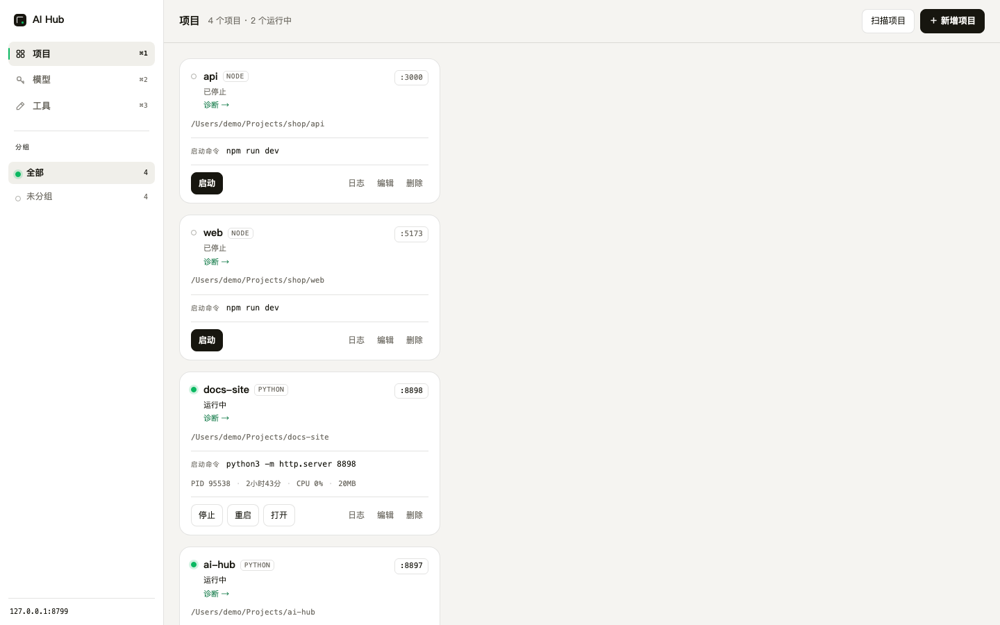
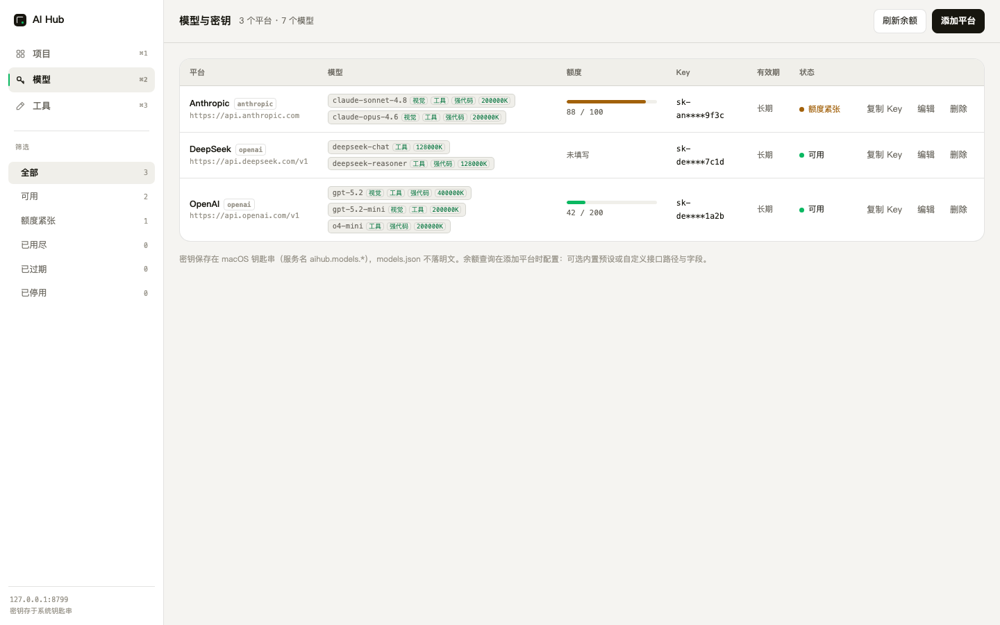
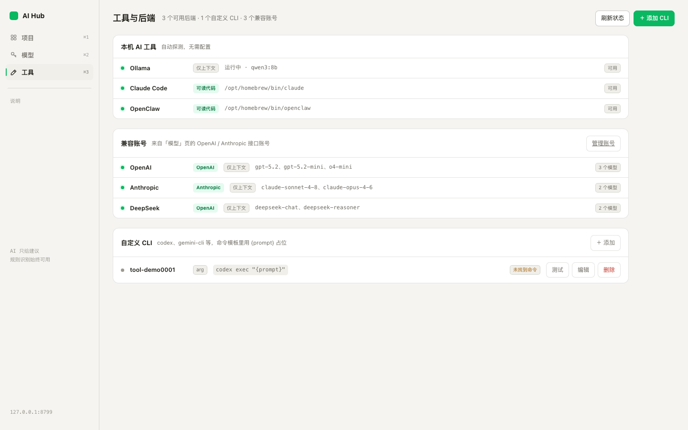

# AI Hub

> 一个零依赖的本地控制台：统一管理本机项目、AI 模型账号与命令行 AI 工具。

[](https://www.python.org/)
[](aihub.py)
[](LICENSE)
[]()

`aihub.py` 是单文件 Python 程序，只用标准库，没有 `requirements.txt`，也没有构建步骤。运行后在本机 `http://127.0.0.1:8799` 打开四个页面：

| 页面 | 解决什么问题 |
| --- | --- |
| **项目** | 几十个本地项目，不知道该用哪条命令启动、端口被谁占了 |
| **模型** | 多个平台的 API Key 散落在各处，模型能力、余额、可用性心里没数 |
| **工具** | Ollama / Claude Code / OpenClaw 装没装、能不能用、该用哪个模型 |
| **资产**（`/assets`，`⌘4`） | 盘点本机全部可识别资产的磁盘占用、分类、来源与运行状态，支持筛选、标记、证据链、可回收建议、快照对比与导出 |

## 截图

项目页：运行状态、端口、PID、CPU/内存、启动命令、环境诊断一目了然。



模型页：按平台管理账号，模型能力标签、余额、有效期、连通性集中展示。



工具页：本机 AI 工具自动探测，兼容账号与自定义 CLI 统一调度。



## 功能

### 项目
- 自动扫描目录，识别 Node / Python / Java / Go 等项目并给出启动命令与端口
- 启动命令会**实际执行验证**，失败时调用 AI 结合报错给出修正建议
- 卡片展示运行状态、端口、PID、CPU、内存、运行时长，端口可点击直达
- 一键启动 / 停止 / 重启 / 查看日志；识别到后台入口时提供独立按钮
- 环境诊断：对比项目声明的 Node / Python / Java 版本与本机版本，给出缺失依赖提示
- 同一项目的多个服务自动分组并排展示

### 模型与密钥
- 多平台账号统一管理，支持 OpenAI 与 Anthropic 两种协议
- 每个模型可标注能力标签（视觉、工具调用、代码强度、速度、价格、上下文长度），支持按模型名自动推测
- 余额查询：内置常见平台预设，也支持自定义路径与字段映射
- 一键拉取模型列表、测试连通性、复制密钥
- **API Key 存入系统钥匙串**，配置文件只保留引用与掩码

### 工具
- 自动探测 Ollama / Claude Code / OpenClaw，展示可用状态与路径
- 兼容账号可直接用于对话，无需重复配置
- 支持自定义 CLI 工具，用 `{prompt}` 占位符接入任意命令行 AI

### 资产
- 只读扫描：项目、CLI、运行时、多版本 Python/JDK、依赖目录、模型缓存、容器、后台服务
- 数据来源包括 aihub 现有记录、Homebrew、pyenv / uv / rustup、npm / pipx 与已知工具目录；非 AI 资产同样收录
- 总占用、分类占比、占用 Top 10、最近新增；表格 / 目录树两种视图，支持按类别、来源、AI 标签、状态、收录状态筛选
- 「AI 相关」只是标签和快捷视图，不是准入条件；未知来源也照常展示
- 忽略、标签、备注保存在本机配置，优先级高于自动推断
- 来源证据链：每条资产显示发现来源、判定依据、置信度（高/中/低/未知）与脱敏后的证据；AI 相关区分「是/未知/否」，标签基于推断不等于事实
- 快照与差异对比：可保存最多 20 份快照，对比任意两份快照或「快照 → 当前清单」，按资产路径识别新增 / 消失 / 变大 / 变小 / 属性变化，展示字段级变更明细；大小变化小于 1KB 视为噪声
- 导出：可把当前筛选结果或全部清单导出为 CSV / JSON；证据链已脱敏，导出全程在本机浏览器完成，不联网
- 可回收建议：每条资产标注「可回收 / 谨慎回收 / 不建议回收 / 待确认」及原因，汇总可回收大小；「可回收」快捷视图只看有回收空间的项。**当前版本只给建议，不删除任何文件**，实际清理留待 P2
- 默认只扫 `~/code`、`~/Projects`、`~/workspace`；个人目录需在配置里显式填写，扫描过程不修改任何文件

## 快速开始

要求：macOS，Python 3.9+，无需安装任何第三方包。

```bash
git clone <this-repo> aihub
cd aihub
python3 aihub.py
```

浏览器会自动打开 `http://127.0.0.1:8799`。首次运行会在脚本目录生成数据文件，可参考示例文件了解结构：

```bash
cp projects.example.json projects.json   # 可选：预置项目列表
cp models.example.json models.json       # 可选：预置模型账号（密钥仍需在页面里填写）
```

修改端口：编辑 [aihub.py](aihub.py) 顶部的 `PORT`。

## 数据文件

所有数据都放在脚本同目录，均为纯 JSON，可直接查看或版本管理（但**不要提交到公开仓库**，见[安全说明](#安全说明)）。

| 文件 | 用途 | 是否应提交 |
| --- | --- | --- |
| `projects.json` | 项目列表与启动配置 | 否（含本机绝对路径） |
| `projects.runtime.json` | 运行中项目的 PID 记录 | 否（自动生成） |
| `models.json` | 模型账号、模型清单、能力标签 | 否（含平台与账号信息） |
| `envs.json` | 每个项目的 Node 版本偏好 | 否 |
| `ai_tools.json` | 自定义 CLI 工具 | 否 |
| `assets.json` | 资产页的扫描根目录、排除规则、忽略/标签/备注 | 否（含本机路径） |
| `assets.index.json` | 最近一次资产扫描结果缓存 | 否（自动生成） |
| `assets.snapshots/` | 资产快照（最多 20 份），用于差异对比 | 否（自动生成） |
| `logs/`、`uploads/` | 项目日志、对话上传的图片 | 否 |

`.gitignore` 已默认排除以上全部内容。

## 安全说明

- 服务只监听 `127.0.0.1`，不对外网暴露
- 所有请求校验 `Host` 与 `Origin`，只接受 `127.0.0.1` / `localhost` / `[::1]` 对应端口，防止 DNS rebinding
- 写接口要求请求头 `X-AIHub: 1` 且 `Content-Type: application/json`：浏览器必须先发预检，跨站页面无法伪造，从而阻断 CSRF
- 请求体上限 64MB，超出直接返回 `413`
- 统一响应安全头：`Content-Security-Policy`、`X-Frame-Options: DENY`、`X-Content-Type-Options: nosniff`、`Referrer-Policy: no-referrer`
- API Key 保存在 macOS 钥匙串（service `aihub`），`models.json` 中只有 `key_ref` 引用与 `sk-****abcd` 形式的掩码
- 接口永不返回完整密钥，复制密钥由本地进程直接写入剪贴板
- 启动项目、删除配置属于高风险操作，请勿把本服务反向代理到公网

命令行调试写接口时需要带上同样的请求头：

```bash
curl -H 'X-AIHub: 1' -H 'Content-Type: application/json' \
  -d '{}' http://127.0.0.1:8799/api/projects/scan
```

## 平台支持

当前仅支持 macOS（依赖 `security` 钥匙串、`lsof` 端口探测、Homebrew 路径探测）。Linux / Windows 适配在路线图中。

## Roadmap

- [ ] 平台抽象层：Linux（`secret-tool` / `ss` / `/proc`）与 Windows（DPAPI / `netstat`）
- [ ] `aihub mcp`：以 MCP server 形式让 Claude Code、Cursor 等直接启停项目、查询端口
- [ ] CLI：`aihub status / start / stop / scan --json`
- [x] 请求安全加固：校验 `Host` / `Origin`、强制自定义请求头、补充 CSP
- [ ] 单元测试与 macOS / Linux / Windows 三平台 CI
- [ ] 英文界面

## 参与贡献

- Issue 请说明系统版本、Python 版本、复现步骤与相关日志
- PR 请保持“零第三方依赖”这一约束，新增功能需附带说明
- 提交前请确认没有把 `models.json`、`projects.json`、`logs/` 等本机数据带入改动

## License

[MIT](LICENSE)

---

## English

**AI Hub** is a zero-dependency, single-file local dashboard for managing development projects, AI model accounts, and command-line AI tools — all from `http://127.0.0.1:8799`.

- **Projects** — scans your folders, detects start commands and ports, actually verifies them, and shows running state, PID, CPU/memory, logs, and environment version issues.
- **Models** — manages multi-vendor API accounts (OpenAI / Anthropic compatible), per-model capability tags, balance queries, and connectivity tests. Secrets live in the macOS Keychain; config files only hold references and masked hints.
- **Tools** — detects Ollama, Claude Code, and OpenClaw, and lets you plug in any CLI via a `{prompt}` template.

```bash
python3 aihub.py   # requires Python 3.9+ on macOS, no pip install
```

Data files (`projects.json`, `models.json`, `envs.json`, `ai_tools.json`, `assets.json`, `assets.index.json`, `assets.snapshots/`, `logs/`, `uploads/`) are local-only and git-ignored. See [*.example.json](models.example.json) for their shape.

macOS is the only supported platform today; Linux and Windows support, an MCP mode, and a CLI are on the roadmap. MIT licensed.
